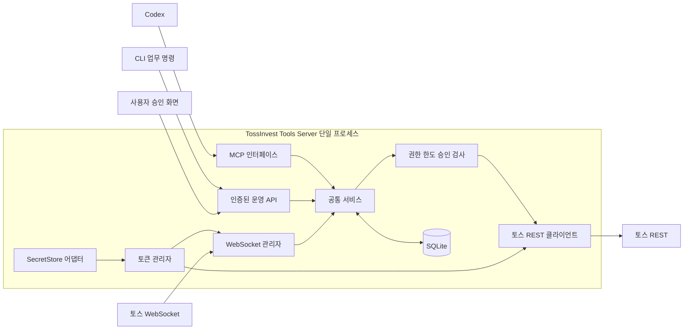

# 구조 설계

서버 하나가 토스 연결과 상태를 소유합니다. MCP, CLI 업무 요청, 사용자 승인 화면은 같은 서비스 로직을 사용합니다. MCP 연결 수나 대화 수가 늘어도 토스 클라이언트와 토큰 관리자를 새로 만들지 않습니다.

## 실행 구성

초기 기본 접속 주소는 `http://127.0.0.1:17840`입니다. `/mcp`에 Streamable HTTP와 최소 health·상태 조회를 제공합니다. readonly에서는 주문 준비·실행·승인 API를 등록하지 않습니다. 승인 기능은 선택적 trading 모듈에서 추가합니다. 외부 바인딩은 초기 설정에서 허용하지 않습니다. 최소 접속·응답 계약은 [인터페이스](interfaces.md)를 따릅니다.

시작 시 mode와 backend를 확정하고 불변의 capability registry를 구성합니다. 등록 필터에 더해 공통 서비스와 broker 전송에서도 프로필을 확인합니다. [실행 프로필](runtime-profiles.md)이 권한 상한의 기준입니다.

`serve`는 독립 실행합니다. Codex가 시작하거나 대화를 열 때마다 토스 서버를 STDIO 자식으로 생성하지 않습니다. 토스 소켓과 주문 상태가 MCP 세션 수명에 종속되지 않게 합니다. 향후 STDIO 호환이 필요하면 기존 서버에 연결하는 제한된 어댑터로 추가하고 토스 연결을 복제하지 않습니다.

R1의 계좌 선택은 `setup accounts`가 소유자 전용 Unix socket으로 같은 서버를 호출합니다. 토큰·계좌 발견·별칭·권한 revision은 서버가 소유하며 MCP와 TCP HTTP에는 이 소유자 변경 경로를 등록하지 않습니다. OS UID 검사는 같은 사용자 셸에 대한 격리가 아니며 trading 승인의 별도 인증을 대체하지 않습니다. [ADR 0004](decisions/0004-readonly-access-and-event-history.md)에 조회용 기본안과 대안을 기록합니다.

## 컴포넌트 책임

| 컴포넌트 | 책임 | 소유하지 않는 것 |
|---|---|---|
| MCP transport | 도구 발견·입력 스키마·결과·프로토콜 오류 | 토스 키, 최종 승인 판정 |
| CLI | 로컬 setup·serve·진단과 서버 요청 | 독립 토스 세션·별도 주문 제한 |
| 운영 API와 UI | 상태 확인·사용자 인증·승인 제출 | 모델이 사용할 승인 우회 경로 |
| 서비스 | 계좌 컨텍스트·조회·초안·실행·동기화 | wire 형식의 중복 구현 |
| 정책·승인 모듈 | 주체·계좌·행동·한도·증거·만료 검사 | 자연어를 동의로 추정하는 일 |
| REST 어댑터 | 생성 클라이언트, 헤더, 오류 분류, 제한·재시도 | 주문 재시도 여부의 독자 결정 |
| 토큰 관리자 | client당 단일 토큰·갱신 잠금·만료·재발급 | 토큰을 도구 결과로 반환하는 일 |
| WS 관리자 | 구독 전체 상태·ACK·PING·백오프·수신·복구 | MCP 클라이언트의 연결 수명 |
| 저장소 | 주문·승인·전송 기록·예약 노출·동기화 시각·마이그레이션 | 평문 client_secret, 일반 로그 원문 |
| SecretStore | OS별 비밀 저장·조회 | 도구로 비밀 읽기 제공 |
| MCP credential provider | toss는 전용 Keychain 항목, mock는 실행별 credential 파일과 메모리. 주체/scope와 연결 | 토스 토큰·소유자 승인 증거 |
| 로컬 소유자 소켓 | peer UID 검증, 계좌 발견·선택과 권한 revision 변경 | HTTP/MCP를 통한 권한 상향·trading 승인 |

## Go 기본안

HTTP는 `net/http`, MCP는 공식 `github.com/modelcontextprotocol/go-sdk`를 사용합니다. REST 타입과 호출 코드는 `oapi-codegen`을 첫 후보로 검증합니다. WebSocket은 `github.com/coder/websocket`, Decimal은 `github.com/shopspring/decimal`, SQLite는 `database/sql`과 `modernc.org/sqlite`를 후보로 합니다.

Go의 지원 중인 안정 버전과 각 라이브러리의 검증한 버전을 고정합니다. 2026년 10월 26일 조사 기준 Go 1.27 계열과 `oapi-codegen` v2.8.0이 검증 출발점이며, 실제 의존성 확정은 P0 결과를 ADR 0001에 반영한 시점입니다. 시스템 설치 여부만으로 버전을 선택하지 않습니다.

OpenAPI 3.1의 null union, `oneOf`·`allOf`, Decimal 문자열, 오류 envelope, form-urlencoded 인증을 실제 명세로 검증합니다. 생성기로 표현이 불충분한 부분은 별도 adapter·validation으로 보완합니다. 생성 성공만으로 유효한 요청·응답 처리를 보장하지 않습니다.

## 예정된 코드 경계

아래는 원래 경계 계획입니다. 현재 readonly R2는 `internal/core`(공통 업무/권한/WS), `internal/runtime`(MCP/HTTP/소켓/수명), `internal/broker/toss`·`mock`, `internal/store`, `internal/platform`, `internal/cli`, `cmd/tossinvest-tools`로 구현했습니다. 초기에는 정책을 core에 모으고 주문 approval 패키지는 만들지 않았습니다. 현재 코드/검증은 [인수인계](handoff.md)와 [adapter 기록](adapter-notes.md)을 따릅니다.

| 경계 | 예정 위치와 역할 |
|---|---|
| 실행 진입점 | `cmd/tossinvest-tools`: setup·serve·doctor·service와 종료 코드 |
| 설정·실행 수명 | `internal/runtime`: 설정 검증, 단일 인스턴스, 시작·종료·준비 상태 |
| 토스 연결 | `internal/broker/toss`: 인증·오류·제한·WS, 하위 `generated`에 생성 코드 |
| 공통 업무 | `internal/service`: 조회·초안·실행·동기화 |
| 권한과 승인 | `internal/policy`, `internal/approval` |
| 저장소 | `internal/store`: SQL과 버전별 마이그레이션 |
| 접속 인터페이스 | `internal/transport/mcp`, `internal/transport/admin` |
| 운영체제 연동 | `internal/secrets`, `internal/platform` |

MCP 도구마다 토스 호출을 직접 복사하지 않습니다. 중개 계층과 업무 검증을 공통 서비스에 두어 HTTP·CLI·MCP의 정책 차이를 없앱니다. 초기에는 모듈 하나로 충분하며 다중 서비스·범용 플러그인 시스템을 도입하지 않습니다.

## 시작과 종료

시작 순서는 설정·프로필 검증 → 단일 프로세스 잠금 → 필요한 DB migration과 인터페이스 준비 → 실제/모의 연결 준비 → 제공 기능별 준비 상태 전환입니다. backend=mock는 실제 비밀 저장소와 토스 접속을 건너뜁니다. 토스 키가 없거나 연결이 끊겨도 인증된 진단을 제공하고 query_ready=false로 표시합니다.

query_ready·streams_ready·trading_ready를 구분합니다. readonly REST 조회는 미구현 승인 서비스·주문 저널·WS 기능의 준비를 기다리지 않습니다. trading 모듈은 추가 준비 검증을 하고, 계좌별 동기화·미확정 주문이 해결되기 전 신규 쓰기를 거부합니다. readonly에서 trading_ready=false는 정상 상태입니다.

종료 신호를 받으면 신규 쓰기 접수를 막고, 제한 시간 안에 in-flight 작업의 결과를 기록합니다. 결과를 못 받으면 미확정으로 남깁니다. 그 뒤 WS와 DB를 닫습니다. 프로세스 재시작·종료는 이미 제출된 주문의 취소가 아닙니다.

## 동시성과 영속 상태

- 한 프로세스에서 goroutine과 `context` 취소를 사용합니다. 계좌별 쓰기 예약과 승인 소비는 직렬화하거나 원자적 비교 갱신으로 보호합니다.
- 토큰 갱신은 single-flight로 묶습니다. 동시에 여러 요청이 401을 받아도 재발급 폭주를 만들지 않습니다. 유효한 새 토큰을 다시 무효화하는 루프를 막습니다.
- R1·R2의 DB는 schema metadata·조회 cache·계좌 별칭·동기화·수신 이벤트처럼 필요한 상태만 갖춥니다. 초안·승인·제출 저널·정책 예약은 P4에서 additive migration으로 추가합니다. 읽기 전용의 출시를 거래 schema 설계에 종속시키지 않습니다.
- 계좌 허용 관계·access_revision과 주문 ID 소유 관계는 cache와 구분해 저장합니다. ID 관계는 backend·client·자원 종류별이며 확인된 타 계좌를 거부하고 unknown의 조회는 [계좌 한정 단건 GET](interfaces.md#주문-id와-계좌-소유-관계)으로만 확인합니다. mock 상태는 별도 DB에 두며 toss DB를 복사하거나 자동 전환하지 않습니다.
- 승인 소비·한도 예약·전송 의도 기록은 하나의 트랜잭션으로 커밋하고 네트워크에 나갑니다. 네트워크를 기다리며 DB 잠금을 유지하지 않습니다.
- upstream 호출과 로컬 DB는 하나의 원자적 트랜잭션이 될 수 없습니다. 커밋 후 전송 전 종료와 전송 후 응답 전 종료를 모두 미확정 복구 대상으로 취급합니다.
- SQLite의 주문 기록 DB는 WAL, `synchronous=FULL`, 외래 키 검사와 유한한 busy timeout을 기본으로 검증합니다. 마이그레이션과 오류 복구를 포함하며 DB 잠금만으로 서버 중복 실행을 허용하지 않습니다.
- 시세는 최신 스냅샷 위주로 제한된 메모리에 보관합니다. 주문 이벤트 수신 경로에서 긴 계산·네트워크·전체 시세 저장을 수행하지 않습니다.

## 시세와 이벤트 제공

MCP의 호출·알림 기능을 토스 원본 스트림의 영구 전송 보장으로 간주하지 않습니다. 서버는 WS를 독립 수신하고, 도구는 관리되는 구독, 최신 스냅샷, 수신 이벤트 페이지와 연결 상태를 제공합니다. 클라이언트가 지원하면 MCP 알림을 추가하되 조회로 상태를 복구할 수 있게 합니다.

이벤트 로컬 커서는 우리 서버가 저장한 수신 순서입니다. upstream의 유실 검출 sequence가 아니며 끊긴 구간을 복원하지 못합니다. `gap_detected`, `last_synced_at`, 데이터 기준 시각을 함께 다룹니다. 로컬 기록을 계좌 전체의 누락 없는 체결 원장이라고 설명하지 않습니다. readonly로 재시작할 때 이전 trading 제출 기록이 있더라도 조회만으로 확인하며 실제 재전송은 하지 않습니다.

## 이벤트 보존과 수신 큐

다음 값은 upstream 보장이 아니라 R2의 로컬 기본값입니다. 초기에는 고정 상수로 검증하고 소유자 설정에 노출할 때 유한한 상한과 이전 계약을 추가합니다.

| 대상 | 기본 한도와 동작 |
|---|---|
| 수신 주문 이벤트 DB | 수신 UTC 시각 기준 7일, 계좌당 100,000건, 전체 저장 payload 256 MiB 중 먼저 도달한 한도 적용. 오래된 수신 순서부터 삭제 |
| 주문 이벤트 수신 큐 | 최대 1,024건 또는 payload 8 MiB. 가장 오래 기다린 항목이 1초 이상이면 포화와 같은 복구 경로 적용 |
| 수신 메시지 | 디코딩 전 최대 1 MiB. 초과·디코딩 불가 메시지는 데이터 손상으로 표시하고 연결 복구 |
| 체결·호가 | 허용 구독의 `(채널, 종목)`별 최신 스냅샷 하나만 유지. 별도 과거 tick DB를 만들지 않음 |

수신 시각은 내부에서 부여하고 순서값은 DB에서 단조 증가시키며 upstream 체결 시각과 구분합니다. 원본 시각은 그대로 보존합니다. 보존 만료는 적어도 60초마다 및 이벤트 페이지 조회 전에 적용하며, 건수·payload 한도는 새 배치 커밋 시 적용합니다. 삭제와 계좌별 `pruned_through_seq`·`history_truncated` 갱신은 같은 트랜잭션입니다. payload 한도는 SQLite 파일의 물리적 크기 보장이 아니며, 정리된 page 재사용·백업을 고려해 디스크 상태를 진단합니다.

7일 경계와 같은 수신 시각은 만료 대상으로 합니다. 삭제는 계좌별 수신 순서의 연속된 앞부분으로만 수행하여 watermark보다 큰 위치에 숨은 구멍을 만들지 않습니다. OS 시각 역행으로 기간과 순서가 어긋나면 기간 삭제를 보수적으로 지연하되 건수·payload 상한은 유지합니다. 큐는 한도 안까지 받아들이고 다음 항목이 건수/바이트 한도를 초과하거나 최장 대기가 1초 이상이면 복구를 시작합니다.

계좌별 건수와 기간 만료 뒤 전체 payload가 초과하면 전체에서 가장 오래된 이벤트부터 삭제하고 영향받은 계좌에만 보존 경계를 반영합니다. 이 정책은 수신 관측 이력에만 적용합니다. 계좌 허용·동기화 상태·미확정 작업·P4 승인/제출/감사 저널은 함께 삭제하지 않습니다.

주문 이벤트는 별도 writer가 먼저 커밋한 뒤 조회에 노출합니다. 위 큐 포화 조건이 발생하면 reader를 기다리게 하거나 조용히 이벤트를 버리지 않습니다. 연결을 닫고 해당 연결 세대의 `gap_detected=true`, 계좌 `sync_status=recovering`으로 전환하며, 수신한 배치는 가능한 범위에서 기록합니다. 저장이 회복되면 새 연결에서 구독과 제한된 이벤트 버퍼를 먼저 복구하고 REST 재동기화를 겹쳐 수행해 스냅샷 이후 이벤트가 빠지는 구간을 만들지 않습니다. 다시 포화하면 준비를 유지하지 않고 재복구합니다. 제어 메시지·PING은 느린 DB writer를 기다리지 않습니다. 시세 coalescing과 달리 주문 이벤트는 무표시 덮어쓰기를 허용하지 않습니다.

DB 쓰기 실패로 누락 표시도 저장할 수 없으면 메모리에서 즉시 미준비를 표시하고 저장 복구 시 함께 기록합니다. 모든 프로세스 재시작은 이전 연결의 관측 중단으로 취급하므로 강제 종료 직전의 gap 표시가 유실되어도 연속 수신으로 판단하지 않습니다. 저장·REST 동기화가 실패하는 동안 관련 계좌의 실시간 준비와 신규 쓰기를 차단하지만 독립적인 REST 조회는 가능한 범위에서 유지합니다.

REST 재동기화는 현재 계좌 상태를 확인하며 누락된 이벤트 이력을 복원하지 않습니다. 현재 상태의 `sync_status=synced`와 관측 이력의 `gap_detected=true`를 함께 표시할 수 있고, trading 재개는 현재 동기화·미확정 결과·정책 준비를 별도로 검사합니다. 초기 관측 이후 발생한 gap은 해당 프로세스의 관측 세대 동안 상태에 유지하고 다음 재시작에도 마지막 중단 구간을 표시합니다. 보존 삭제는 `history_truncated`로 별도 표시합니다. 페이지·만료·권한 재검사 계약은 [이벤트 커서](interfaces.md#주문-이벤트-페이지와-커서)를 따릅니다.

## 향후 서버 이전

SecretStore, 프로세스 관리, 파일 경로만 OS 어댑터로 나눕니다. 원격 서버 이전 시에는 HTTPS·사용자 OAuth·안전한 출구 IP·별도 운영 계정·백업을 추가 검토합니다. SQLite를 유지할지 바꾸는 결정은 동시 운영 요구에 근거합니다. 초기부터 다중 인스턴스 주문 실행을 지원한다고 가정하지 않습니다.
